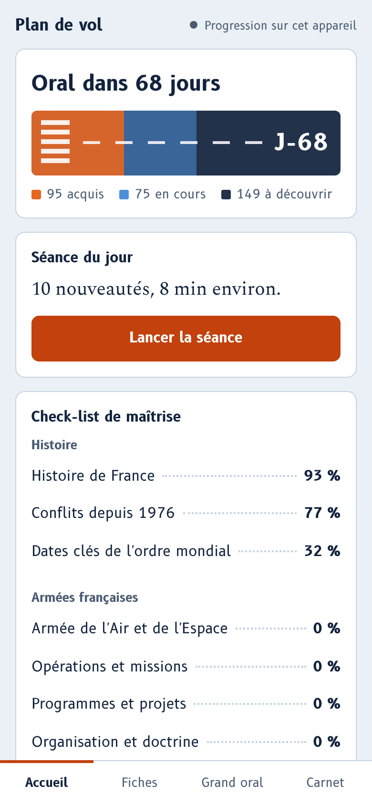
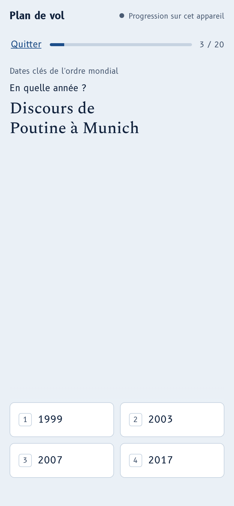
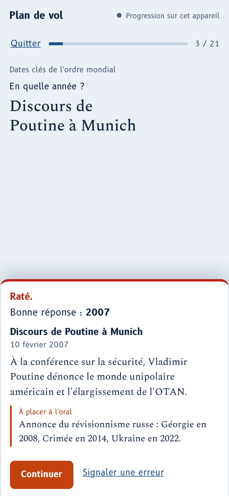
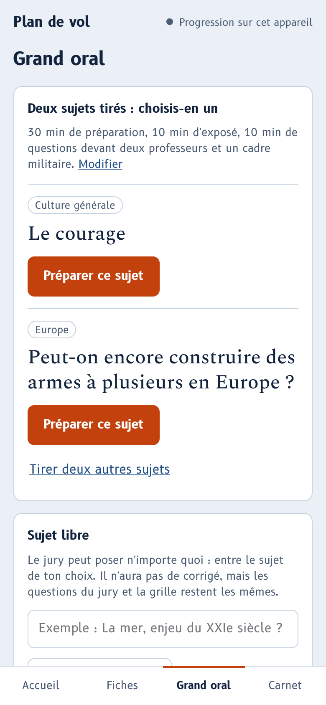

# Plan de vol

Application de révision pour préparer un grand oral de culture générale, d'histoire, de géopolitique et de défense. Elle s'installe sur l'écran d'accueil du téléphone et fonctionne sans connexion.

**[Ouvrir l'application](https://jealouself.github.io/plan-de-vol/)**

<p>
  
  
  
  
</p>

## Ce qu'elle fait

- **319 fiches en 7 packs** : histoire de France, conflits depuis 1976, dates clés de l'ordre mondial, armée de l'Air et de l'Espace, opérations et missions, programmes et projets, organisation et doctrine. Un pack d'actualité s'y ajoute chaque semaine.
- **Une séance par jour**, calculée par répétition espacée : quelques nouveautés, puis les fiches à revoir au bon moment. Les questions passent du choix multiple à la question ouverte à mesure qu'une fiche est acquise.
- **Deux entraînements** : le blitz chronométré et la frise chronologique.
- **Un grand oral blanc** : deux sujets au choix, préparation, exposé et questions minutés, relances du jury, grille d'auto-évaluation, corrigé pour 20 sujets.
- **Hors connexion** : une fois installée, l'application n'a plus besoin de réseau.
- **Synchronisation facultative** entre téléphone et ordinateur, dans un fichier privé de ton propre compte GitHub. Il n'y a ni serveur ni traceur : ta progression ne va nulle part ailleurs.

## Utiliser l'application

1. Ouvre [jealouself.github.io/plan-de-vol](https://jealouself.github.io/plan-de-vol/).
2. Ajoute-la à ton écran d'accueil :
   - iPhone : dans Safari, bouton Partager, puis « Sur l'écran d'accueil » ;
   - Android : dans Chrome, menu, puis « Installer l'application » ;
   - ordinateur : mets-la en favori, ou installe-la depuis la barre d'adresse de Chrome ou d'Edge.
3. Ouvre-la une première fois avec du réseau. Dans Réglages, la ligne « Hors connexion » doit indiquer « Prête à fonctionner sans réseau ».

### Retrouver sa progression sur plusieurs appareils

1. Dans l'application, ouvre Réglages puis « Créer un jeton sur GitHub ». Le formulaire est prérempli avec le seul droit nécessaire, `gist`.
2. Choisis une date d'expiration, génère le jeton et copie-le.
3. Colle-le dans l'application et active la synchronisation.

Répète ces trois étapes sur chaque appareil, avec un jeton par appareil. La progression est enregistrée dans un gist secret de ton compte, nommé `plan-de-vol-progression.json`. Sur iPhone, colle le jeton dans l'application ouverte depuis l'icône, pas dans Safari : les deux ne partagent pas leurs données.

## Signaler une erreur, proposer une fiche

Sous chaque fiche, le lien « Signaler une erreur » ouvre un signalement prérempli. Tu peux aussi passer par l'onglet [Issues](https://github.com/JealousElf/plan-de-vol/issues). Les règles sont dans [CONTRIBUTING.md](CONTRIBUTING.md).

## Héberger ta propre copie

Utile seulement si tu veux modifier les fiches ou le code. Il n'y a rien à compiler.

1. Clique sur **Fork** en haut de cette page.
2. Dans ton dépôt : Settings, Pages, « Deploy from a branch », branche `main`, dossier `/ (root)`, puis Save.
3. Après une minute, ta copie est en ligne sur `https://TON-IDENTIFIANT.github.io/plan-de-vol/`.

Pour recevoir les nouvelles fiches et le pack d'actualité, utilise le bouton « Sync fork » de ton dépôt.

## Développer

Il faut Node 22 ou plus récent.

```bash
git clone https://github.com/JealousElf/plan-de-vol.git
cd plan-de-vol
npm install
npx playwright install chromium
npm run servir      # l'application sur http://127.0.0.1:8080
npm test            # vérifie les fiches, puis joue les parcours dans un navigateur
npm run sw          # à lancer après toute modification, pour que la mise à jour hors connexion se fasse
```

Pour ne vérifier que les fiches, sans navigateur : `node --test tests/donnees.test.mjs`.

### Organisation du dépôt

| Chemin | Contenu |
| --- | --- |
| `index.html`, `styles.css`, `app.js` | L'application, sans framework ni étape de compilation |
| `data/` | Les fiches (un fichier par pack), les sujets de grand oral, le pack d'actualité `actu.json` |
| `sw.js` | Le service worker : mise en cache à l'installation, fonctionnement hors connexion |
| `fonts/`, `icons/`, `manifest.webmanifest` | Polices locales, icônes, manifeste d'installation |
| `outils/` | Serveur local, mise à jour de `sw.js`, captures d'écran du README |
| `tests/` | Tests des fiches et des parcours (Playwright) |

## Licences

- Code : [MIT](LICENSE).
- Fiches et sujets du dossier `data/` : [CC BY-SA 4.0](LICENCE-CONTENU.md).
- Polices B612 et Spectral : SIL Open Font License 1.1, voir `fonts/OFL.txt`.

## Avertissement

Plan de vol est un projet libre et indépendant, sans lien avec le ministère des Armées ni avec une école. Les fiches ont été rédigées avec l'aide d'une IA à partir de sources publiques ; les faits d'actualité ont été recoupés en ligne à la date affichée sur la fiche. Une erreur reste possible : vérifie ce qui compte pour toi et signale ce qui te paraît faux.
