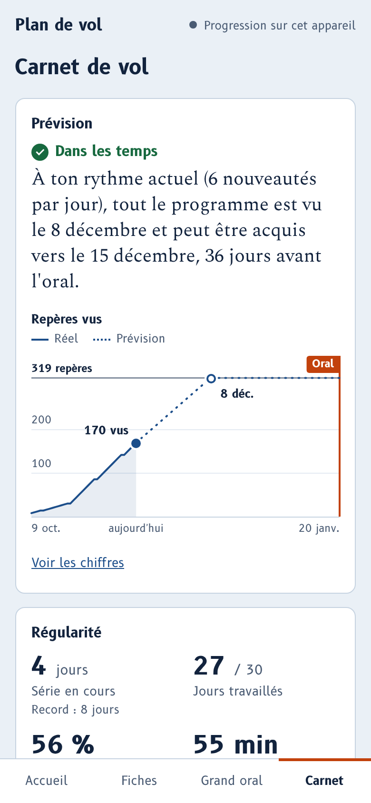

# Plan de vol

Application de révision pour préparer un grand oral de culture générale, d'histoire, de géopolitique et de défense. Elle s'installe sur l'écran d'accueil du téléphone et fonctionne sans connexion.

**[Ouvrir l'application](https://jealouself.github.io/plan-de-vol/)** · [Guide d'utilisation en PDF](docs/guide-utilisation.pdf)

<p>
  
  
  
  
  
</p>

## Ce qu'elle fait

- **376 fiches en 8 packs** : histoire de France, conflits depuis 1976, dates clés de l'ordre mondial, armée de l'Air et de l'Espace, opérations et missions, programmes et projets, organisation et doctrine, citations célèbres. Un pack d'actualité s'y ajoute chaque semaine.
- **« En savoir plus »** : sous une fiche, un paragraphe de contexte et un lien vers Wikipédia.
- **Les gros titres de l'actualité** sur l'accueil (défense, international, aéronautique et spatial, politique française), mis à jour plusieurs fois par jour ; chaque titre ouvre l'article chez le média qui l'a publié.
- **Une séance par jour**, calculée par répétition espacée : quelques nouveautés, puis les fiches à revoir au bon moment. Les questions passent du choix multiple à la question ouverte à mesure qu'une fiche est acquise. Une séance interrompue se reprend là où tu t'étais arrêté.
- **Deux entraînements** : le blitz chronométré et la frise chronologique.
- **Un grand oral blanc** : deux sujets au choix, préparation, exposé et questions minutés, relances du jury, grille d'auto-évaluation, corrigé pour 20 sujets.
- **Un carnet de vol** qui répond à la seule question utile, « serai-je prêt à temps ? » : prévision jusqu'au jour de l'oral et rythme conseillé en cas de retard, calendrier de régularité, révisions à venir, maîtrise par thème, repères qui résistent, progression des oraux blancs.
- **Hors connexion** : une fois installée, l'application n'a plus besoin de réseau.
- **Synchronisation facultative** entre téléphone et ordinateur, par un simple code à taper une fois. La progression est chiffrée sur l'appareil avant d'être envoyée ; il n'y a ni compte, ni traceur, ni publicité.

## Utiliser l'application

1. Ouvre [jealouself.github.io/plan-de-vol](https://jealouself.github.io/plan-de-vol/).
2. Ajoute-la à ton écran d'accueil :
   - iPhone : dans Safari, bouton Partager, puis « Sur l'écran d'accueil » ;
   - Android : dans Chrome, menu, puis « Installer l'application » ;
   - ordinateur : mets-la en favori, ou installe-la depuis la barre d'adresse de Chrome ou d'Edge.
3. Ouvre-la une première fois avec du réseau. Dans Réglages, la ligne « Hors connexion » doit indiquer « Prête à fonctionner sans réseau ».

### Retrouver sa progression sur plusieurs appareils

1. Sur le premier appareil, ouvre Réglages puis « Créer un code de synchronisation ». L'application affiche un code de seize caractères.
2. Sur l'autre appareil, ouvre Réglages, tape ce code sous « J'ai déjà un code », puis « Relier cet appareil ».

C'est tout : il n'y a ni compte ni mot de passe. La progression est chiffrée sur l'appareil avant de partir, avec une clé calculée à partir du code ; le service en ligne ne garde qu'un texte illisible. Le code est donc la seule clé : garde-le pour toi et note-le quelque part.

Sur iPhone, fais ces étapes dans l'application ouverte depuis son icône, pas dans Safari : les deux ne partagent pas leurs données.

Cette synchronisation n'apparaît que si le site est relié à un service de stockage (voir [docs/synchronisation.md](docs/synchronisation.md), dix minutes de mise en place, gratuit). Sans lui, ou si tu préfères garder tes données dans ton propre compte, l'application propose l'autre méthode : un jeton GitHub limité au droit `gist`, à coller sur chaque appareil ; la progression vit alors dans un gist secret de ton compte, nommé `plan-de-vol-progression.json`.

## Signaler une erreur, proposer une fiche

Sous chaque fiche, le lien « Signaler une erreur » ouvre un signalement prérempli. Tu peux aussi passer par l'onglet [Issues](https://github.com/JealousElf/plan-de-vol/issues). Les règles sont dans [CONTRIBUTING.md](CONTRIBUTING.md).

## Héberger ta propre copie

Utile seulement si tu veux modifier les fiches ou le code. Il n'y a rien à compiler.

1. Clique sur **Fork** en haut de cette page.
2. Dans ton dépôt : Settings, Pages, « Deploy from a branch », branche `main`, dossier `/ (root)`, puis Save.
3. Après une minute, ta copie est en ligne sur `https://TON-IDENTIFIANT.github.io/plan-de-vol/`.

Pour recevoir les nouvelles fiches et le pack d'actualité, utilise le bouton « Sync fork » de ton dépôt.

## Développer

Il faut Node 22 ou plus récent.

```bash
git clone https://github.com/JealousElf/plan-de-vol.git
cd plan-de-vol
npm install
npx playwright install chromium
npm run servir      # l'application sur http://127.0.0.1:8080
npm test            # vérifie les fiches, puis joue les parcours dans un navigateur
npm run sw          # à lancer après toute modification, pour que la mise à jour hors connexion se fasse
```

Pour ne vérifier que les fiches, sans navigateur : `node --test tests/donnees.test.mjs`.

### Organisation du dépôt

| Chemin | Contenu |
| --- | --- |
| `index.html`, `styles.css`, `app.js` | L'application, sans framework ni étape de compilation |
| `suivi.js`, `graph.js` | Les calculs du carnet de vol et ses graphiques, séparés du reste pour être testés seuls |
| `synchro.js` | La synchronisation par code : code, clés, chiffrement, échanges avec le service |
| `config.js` | Les deux réglages propres au site : adresse du service de synchronisation, dépôt des signalements |
| `data/` | Les fiches (un fichier par pack), les paragraphes « En savoir plus » (`contexte.js`), les sujets de grand oral, le pack d'actualité `actu.json`, les gros titres `news.json` |
| `sw.js` | Le service worker : mise en cache à l'installation, fonctionnement hors connexion |
| `fonts/`, `icons/`, `manifest.webmanifest` | Polices locales, icônes, manifeste d'installation |
| `outils/` | Serveur local, mise à jour de `sw.js`, captures d'écran du README, robot des gros titres (`actualites.mjs`, lancé par `.github/workflows/actualites.yml`) |
| `tests/` | Tests des fiches et des parcours (Playwright) |

## Licences

- Code : [MIT](LICENSE).
- Fiches et sujets du dossier `data/` : [CC BY-SA 4.0](LICENCE-CONTENU.md).
- Polices B612 et Spectral : SIL Open Font License 1.1, voir `fonts/OFL.txt`.

## Avertissement

Plan de vol est un projet libre et indépendant, sans lien avec le ministère des Armées ni avec une école. Les fiches ont été rédigées avec l'aide d'une IA à partir de sources publiques ; les faits d'actualité ont été recoupés en ligne à la date affichée sur la fiche. Une erreur reste possible : vérifie ce qui compte pour toi et signale ce qui te paraît faux.
